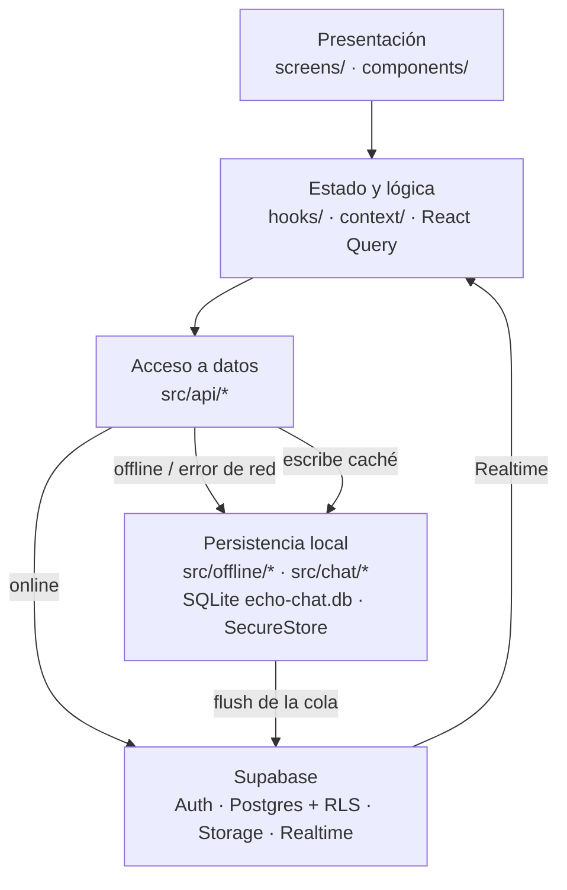
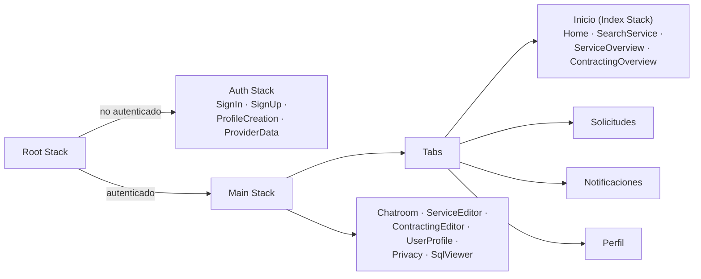
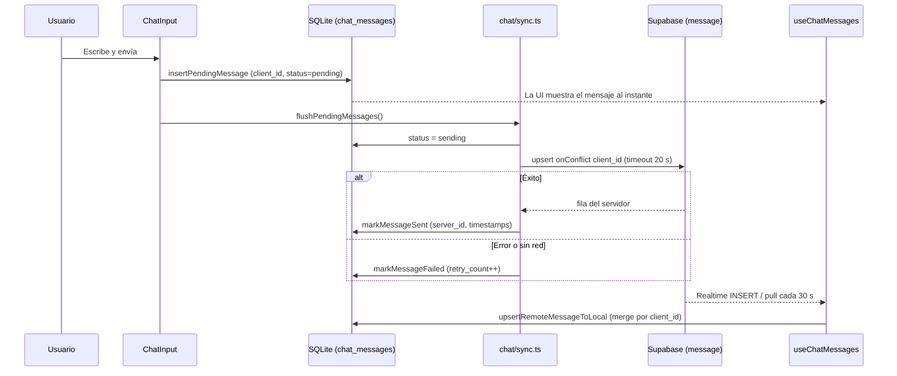
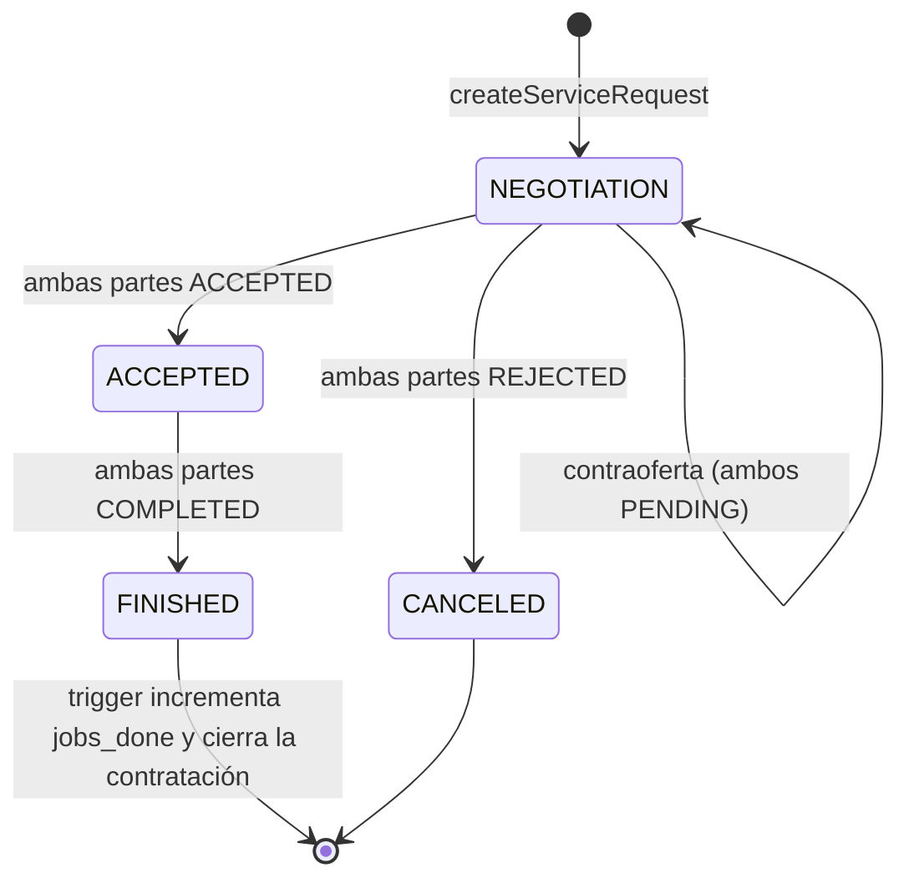

# Manual Técnico — Echo

**Versión:** 2.0
**Fecha:** octubre de 2026

---

## Índice

1. [Introducción](#1-introducción)
2. [Stack tecnológico](#2-stack-tecnológico)
3. [Instalación y ejecución local](#3-instalación-y-ejecución-local)
4. [Estructura del proyecto](#4-estructura-del-proyecto)
5. [Arquitectura](#5-arquitectura)
6. [Módulos](#6-módulos)
7. [Backend (Supabase)](#7-backend-supabase)
8. [Funcionamiento offline-first y sincronización](#8-funcionamiento-offline-first-y-sincronización)
9. [Lógica de negociación](#9-lógica-de-negociación)
10. [Otros flujos técnicos](#10-otros-flujos-técnicos)
11. [Casos de uso por rol](#11-casos-de-uso-por-rol)
12. [Buenas prácticas y convenciones](#12-buenas-prácticas-y-convenciones)
13. [Pruebas](#13-pruebas)
14. [Despliegue](#14-despliegue)
15. [Limitaciones conocidas y trabajo futuro](#15-limitaciones-conocidas-y-trabajo-futuro)

---

## 1. Introducción

### 1.1 Propósito

Este documento describe la arquitectura, la organización del código, los módulos y las prácticas de desarrollo de la aplicación móvil **Echo**. Su objetivo es que un desarrollador pueda comprender, ejecutar, mantener y extender el sistema.

### 1.2 Alcance

El manual cubre la aplicación cliente (React Native / Expo) y su backend en Supabase, en el estado actual del repositorio. El modelo entidad-relación y los requisitos funcionales y no funcionales se documentan por separado y no se repiten aquí.

### 1.3 Audiencia

Desarrolladores, evaluadores técnicos y personal de mantenimiento con conocimientos de TypeScript, React y bases de datos relacionales.

### 1.4 Descripción general del sistema

Echo es un *marketplace* de servicios técnicos (plomería, electricidad, carpintería, etc.) con dos roles:

- **Cliente** (`client`): busca y solicita servicios, y publica contrataciones.
- **Profesional** (`provider`): además de lo anterior, publica servicios y aplica a contrataciones.

Existen dos formas de iniciar una negociación:

1. **Servicio → Solicitud.** Un profesional publica un *servicio* y un usuario le envía una *solicitud* (`service_request`).
2. **Contratación → Aplicación.** Un usuario publica una *contratación* (`contracting`) y los profesionales *aplican*, lo que también genera un `service_request`.

En ambos casos, las partes negocian precio y fecha mediante un chat con un panel de propuestas, hasta aceptar, cancelar o finalizar el trato. La aplicación sigue un enfoque **offline-first**: la información y las acciones se guardan localmente en SQLite y se sincronizan con el servidor cuando hay conexión.

---

## 2. Stack tecnológico

| Capa | Tecnología | Versión |
|---|---|---|
| Framework móvil | Expo (SDK 53) con *New Architecture* habilitada | `expo@53` |
| Runtime UI | React Native / React | 0.79.6 / 19.0.0 |
| Lenguaje | TypeScript (`strict: true`) | ^5.3 |
| Navegación | React Navigation (native-stack, bottom-tabs) | 7.x |
| Estado de servidor | TanStack React Query | ^5.90 |
| Estado local persistente | Zustand (solo tema) | ^5.0 |
| Formularios | react-hook-form | ^7.56 |
| Backend (BaaS) | Supabase: Auth, Postgres, Storage, Realtime | supabase-js ^2.104 |
| Persistencia local | expo-sqlite | ~15.2 |
| Almacenamiento seguro | expo-secure-store | ~14.2 |
| Conectividad | expo-network | ~7.1 |
| Medios y ubicación | expo-image-picker, expo-image, expo-file-system, expo-location | — |
| Gestor de paquetes y pruebas | Bun (`bun install`, `bun test`) | 1.3.x |

Las versiones exactas están en [`package.json`](../package.json).

---

## 3. Instalación y ejecución local

### 3.1 Requisitos

- **Bun** como gestor de paquetes. El repositorio incluye `bun.lock`.
- **Xcode** para iOS o **Android Studio / SDK** para Android.
- Un proyecto de **Supabase** con las migraciones de `supabase/migrations/` aplicadas.
- **Expo Go no sirve.** La app usa módulos nativos (SQLite, SecureStore) y un *development build*; el script `start` ejecuta `expo start --dev-client`.

### 3.2 Variables de entorno

Se definen en un archivo `.env` en la raíz, que no se versiona:

| Variable | Uso | Archivo |
|---|---|---|
| `EXPO_PUBLIC_SUPABASE_URL` | URL del proyecto Supabase. También sirve para derivar la clave de almacenamiento de la sesión. | [`src/lib/supabase.ts`](../src/lib/supabase.ts) |
| `EXPO_PUBLIC_SUPABASE_ANON_KEY` | Clave pública (anon) de Supabase. | [`src/lib/supabase.ts`](../src/lib/supabase.ts) |
| `GOOGLE_MAPS_ANDROID_API_KEY` | Clave de *Maps SDK for Android* para `expo-maps`. Se inyecta en `android.config.googleMaps.apiKey` al hacer *prebuild*. Sin ella el mapa sale en blanco en Android (iOS usa Apple Maps y no necesita clave). Conviene restringirla al paquete `com.anonymous.echoapp` y su SHA-1. | [`app.config.js`](../app.config.js) |

### 3.3 Scripts disponibles

| Script | Comando | Descripción |
|---|---|---|
| `start` | `expo start --dev-client` | Inicia Metro para el *dev client*. |
| `prebuild` | `npx expo prebuild --clean` | Regenera las carpetas nativas `ios/` y `android/`. |
| `prebuild:ios` / `prebuild:android` | `… --platform <p>` | Regenera una sola plataforma. |
| `ios` / `android` | `expo run:<p>` | Compila e instala en un simulador o dispositivo. |
| `web` | `expo start --web` | Destino web; no es un objetivo principal del proyecto. |
| `test` | `bun test` | Ejecuta las pruebas unitarias de `tests/`. |

El [`Makefile`](../Makefile) ofrece atajos como `make dev` (`bun start`) y `reset_node_modules`.

### 3.4 Pasos

```bash
bun install
```

```bash
bun run prebuild
```

```bash
bun run ios
```

Después, en ejecuciones posteriores:

```bash
bun start
```

### 3.5 Base de datos

Las migraciones están en [`supabase/migrations/`](../supabase/migrations). Se aplican con la CLI de Supabase sobre el proyecto vinculado:

```bash
supabase db push
```

### 3.6 Nota sobre iOS

El *config plugin* [`plugins/withFmtConsteval.js`](../plugins/withFmtConsteval.js) modifica el `Podfile` para definir `FMT_USE_CONSTEVAL 0`. Sin este parche, la librería `fmt` no compila con Xcode 16 o superior. Se aplica automáticamente en cada `prebuild`.

---

## 4. Estructura del proyecto

```text
echo-service-marketplace/
├── App.tsx               # Árbol de providers y montaje de la navegación
├── index.ts              # Punto de entrada (registerRootComponent)
├── app.json              # Configuración Expo (ids, permisos, plugins)
├── assets/               # Íconos, splash y fuentes Geist
├── plugins/              # Config plugins de Expo
├── supabase/migrations/  # Esquema, RLS, triggers y RPC versionados
├── tests/                # Pruebas unitarias (bun:test)
├── docs/                 # Manuales
└── src/
    ├── api/              # Acceso a datos (Supabase + caché), uno por entidad
    ├── chat/             # Mensajería offline-first y sincronización del chat
    ├── offline/          # Caché local genérica, cola de mutaciones y auth offline
    ├── context/          # Contextos React (Auth, Offline, Negotiation, Alert)
    ├── navigation/       # Árbol de navegación y control de acceso
    ├── screens/          # Pantallas
    ├── components/       # Componentes de funcionalidad
    │   ├── forms/        # Campos y formularios (react-hook-form)
    │   └── ui/           # Componentes base (Button, Text, modales…)
    ├── hooks/            # Hooks reutilizables (auth, tema, estado de solicitud…)
    ├── models/           # Tipos TypeScript de las filas de la BD
    ├── theme/            # Paletas, tipografía y espaciados
    ├── lib/              # Cliente de Supabase
    └── utils/            # Constantes, formato, validaciones, negociación
```

**Alias de importación** (definidos en [`tsconfig.json`](../tsconfig.json) y resueltos por Metro):

- `@/*` → `src/*`
- `@Assets/*` → `assets/*`

---

## 5. Arquitectura

### 5.1 Vista de capas

La aplicación tiene una arquitectura por capas. La UI nunca accede directamente a Supabase ni a SQLite: siempre pasa por la capa `api/`, que decide entre red y caché.



### 5.2 Composición de la aplicación

[`App.tsx`](../App.tsx) monta los providers en este orden, del más externo al más interno:

1. `QueryClientProvider`: caché de React Query.
2. `Suspense` + `SQLiteProvider`: abre `echo-chat.db` y ejecuta `initChatDatabase`.
3. `AuthProvider`: sesión y usuario ([`src/context/Auth.tsx`](../src/context/Auth.tsx)).
4. `OfflineProvider`: conectividad y vaciado de la cola de mutaciones ([`src/context/Offline.tsx`](../src/context/Offline.tsx)).
5. `ChatSyncProvider`: sincronización del chat ([`src/chat/ChatSyncProvider.tsx`](../src/chat/ChatSyncProvider.tsx)).
6. `AlertProvider`: modal global de alertas.

Dentro de los providers se renderizan `Navigation`, el botón flotante `SqlViewerFab` y el `AlertModal`. Las fuentes Geist se cargan con `useFonts`, y el *splash* se oculta en `onReady` de la navegación.

### 5.3 Navegación

[`src/navigation/Navigation.tsx`](../src/navigation/Navigation.tsx) define un *native stack* raíz. La función `getRootStackAccess` ([`rootAccess.ts`](../src/navigation/rootAccess.ts)) decide qué grupo de pantallas mostrar, según el usuario esté autenticado o no.



- Los stacks están en [`src/navigation/stacks/`](../src/navigation/stacks).
- `navigationRef` permite navegar fuera de los componentes.
- Las pestañas son las mismas para ambos roles. Las diferencias por rol se resuelven dentro de cada pantalla, con `user.role`.

### 5.4 Flujo de datos

**Lecturas.** Cada función de `src/api/*` sigue el mismo patrón. Ejemplo: `listServicesByCategory` en [`src/api/services.ts`](../src/api/services.ts).

1. Si `getOfflineNetworkState()` es `false`, devuelve los datos de la caché SQLite.
2. Si hay red, consulta Supabase, guarda el resultado en caché (`cacheServices`, `cacheServiceRequests`, …) y lo devuelve.
3. Si ocurre un error de red (`isLikelyNetworkError`), cae de nuevo a la caché.

**Escrituras.**

- Con red: se escriben directamente en Supabase.
- Sin red, o ante un error de red:
  1. Se aplican de forma optimista sobre la caché local.
  2. Se registran en la cola `offline_mutation_queue` mediante `enqueueOfflineMutation`.
  3. Se envían más tarde (ver [sección 8](#8-funcionamiento-offline-first-y-sincronización)).

**React Query.** Gestiona el ciclo de vida de las consultas en la UI. Cada módulo de `api/` exporta fábricas de *query keys* (`servicesKeys`, `profilesKeys`, `notificationsKeys`, …) para invalidar consultas de forma consistente.

### 5.5 Contextos

| Contexto | Responsabilidad |
|---|---|
| `Auth` | `user`, `authenticated`, `authMode` (`online`/`offline`), `login`, `offlineLogin`, `logout`. Escucha `supabase.auth.onAuthStateChange` y guarda el perfil en SQLite. |
| `Offline` | `isOnline` (vía `expo-network`), `isSyncing`, `pendingCount`, `syncNow`. Dispara `flushOfflineMutations` y `bootstrapOfflineCacheForUser`. |
| `Negotiation` | Comparte, dentro de la pantalla de chat, la solicitud, el cliente, el proveedor y el sujeto (servicio o contratación). |
| `Alert` | Modal global de alertas y confirmaciones. |

---

## 6. Módulos

### 6.1 `src/api/` — Acceso a datos

Contiene un módulo por entidad:

- [`categories.ts`](../src/api/categories.ts)
- [`services.ts`](../src/api/services.ts)
- [`contractings.ts`](../src/api/contractings.ts)
- [`serviceRequests.ts`](../src/api/serviceRequests.ts)
- [`messages.ts`](../src/api/messages.ts)
- [`notifications.ts`](../src/api/notifications.ts)
- [`profiles.ts`](../src/api/profiles.ts)
- [`reviews.ts`](../src/api/reviews.ts)
- [`storage.ts`](../src/api/storage.ts)

Archivos de apoyo:

- [`common.ts`](../src/api/common.ts): utilidades de errores (`throwIfError`, `isAuthError`).
- [`types.ts`](../src/api/types.ts): tipos de filas con relaciones (por ejemplo, `ServiceWithProvider`).

Ejemplos de funciones principales:

- `createServiceRequest`, para solicitudes y aplicaciones.
- `createNotification`.
- `subscribeToRemoteMessages`, que usa Realtime.
- Subida de imágenes a Storage (`uploadServiceImages`).

### 6.2 `src/offline/` — Caché y cola genérica

| Archivo | Responsabilidad |
|---|---|
| [`store.ts`](../src/offline/store.ts) | Lectura y escritura de las tablas de caché (`cache*`, `listCached*`, `updateCached*`) y de la cola (`enqueueOfflineMutation`, `subscribeOfflineMutationQueue`). |
| [`sync.ts`](../src/offline/sync.ts) | `flushOfflineMutations`: procesa la cola y detecta conflictos (`isRemoteNewer`, `ConflictError`). |
| [`auth.ts`](../src/offline/auth.ts) | Credencial offline: `saveOfflineCredential` y `verifyOfflineCredential`. |
| [`bootstrap.ts`](../src/offline/bootstrap.ts) | `bootstrapOfflineCacheForUser`: precarga los datos del usuario tras un login en línea. |
| [`network.ts`](../src/offline/network.ts) | Estado global de conectividad (`get/setOfflineNetworkState`) e `isLikelyNetworkError`. |
| [`ids.ts`](../src/offline/ids.ts) | `createLocalUuid`: UUID generados en el cliente. |

### 6.3 `src/chat/` — Mensajería

| Archivo | Responsabilidad |
|---|---|
| [`db.ts`](../src/chat/db.ts) | `initChatDatabase`: crea y migra el esquema SQLite (versión en `PRAGMA user_version`). |
| [`messages.ts`](../src/chat/messages.ts) | Operaciones sobre `chat_messages`: `insertPendingMessage`, `markMessageSent`, `markMessageFailed`, `upsertRemoteMessageToLocal`, `listLocalMessagesByRequest`. |
| [`sync.ts`](../src/chat/sync.ts) | Envío de la cola de salida (`flushPendingMessages`) y reintentos (`retryMessageByClientId`). |
| [`ChatSyncProvider.tsx`](../src/chat/ChatSyncProvider.tsx) | Decide cuándo vaciar la cola. Expone `syncVersion`. |
| [`useChatMessages.ts`](../src/chat/useChatMessages.ts) | Lee los mensajes desde SQLite y hace *pull* remoto incremental o completo. |
| [`useUnreadMessageCounts.ts`](../src/chat/useUnreadMessageCounts.ts) | Contadores de mensajes no leídos por solicitud. |

### 6.4 `src/context/` y `src/navigation/`

Están descritos en las secciones [5.3](#53-navegación) y [5.5](#55-contextos).

### 6.5 `src/screens/`

Contiene una pantalla por ruta:

- Autenticación: `SignIn`, `SignUp`, `ProfileCreation`, `ProviderData`.
- Navegación principal: `Home`, `SearchService`, `ServiceOverview`, `ContractingOverview`, `Requests`, `Notifications`, `MyProfile`, `UserProfile`.
- Edición: `ServiceEditor`, `ContractingEditor`.
- Chat y otros: `Chatroom`, `Privacy`.
- Herramientas internas: `SqlViewer`, `ChangeApi`.

Las pantallas se limitan a componer componentes y hooks; la lógica de datos vive en `api/` y en `hooks/`.

### 6.6 `src/components/`

- **Funcionalidad:**
  - `NegotiationBlock` (panel de propuestas)
  - `NegotiationStatusBar`
  - `RequestCard`
  - `ChatInput`, `MessageList`, `MessageField`
  - `ReviewForm`
  - `ServiceCard`, `ContractingCard`
  - `ProfileConfigSection`
  - `SqlViewerFab`
- **`forms/`:** campos basados en react-hook-form:
  - `Field`, `DateField`, `Dropdown`
  - `PhotoPicker`, `AvatarPicker`
  - `RoleSelector`, `WeekdaysPicker`, `StarRatingField`
  - formularios compuestos: `RequestForm`, `ProfileForm`, `ProviderInfoForm`
- **`ui/`:** primitivos visuales:
  - `Button`, `Text`, `Title`, `Divider`, `Loader`
  - `SlideModal`, `AlertModal`
  - `StorageImage`: imágenes de Storage con caché en disco

### 6.7 `src/hooks/`

| Hook | Propósito |
|---|---|
| `auth/useLogin`, `useLogout`, `useRegister`, `useRedirect` | Flujos de autenticación (online y offline). |
| `useRequestStatus` | Transiciones de la negociación (ver [sección 9](#9-lógica-de-negociación)). |
| `useSubscription` | Suscripción Realtime genérica a una tabla. |
| `useChatPresence` | Canal de presencia del chat. Evita notificar a quien ya está viendo la conversación. |
| `useAppTheme`, `useColorScheme` | Tema persistido (Zustand) y paleta resuelta. |
| `useImage`, `useLocation` | Selección de imágenes y geolocalización con permisos. |
| `useStats`, `useJobsDone`, `useCheckReviews`, `useProfile` | Datos derivados del perfil. |

### 6.8 `src/models/`, `src/theme/`, `src/utils/`, `src/lib/`

- **`models/`:** tipos de las entidades: `User`, `ClientProfile`, `ProviderProfile`, `Service`, `Contracting`, `ServiceRequest`, `Message`, `Review`, `Notification`, `Category`.
- **`theme/theme.ts`:** colores de marca, paletas clara y oscura (`appThemes`), tipografía Geist, tamaños, espaciados y radios.
- **`utils/`:**
  - [`validations.ts`](../src/utils/validations.ts): reglas reutilizables para react-hook-form.
  - [`format.ts`](../src/utils/format.ts): fechas en es-MX, fechas relativas y `resolveStorageUrl`.
  - [`negotiation.ts`](../src/utils/negotiation.ts) y [`negotiationSubject.ts`](../src/utils/negotiationSubject.ts): predicados de la negociación.
  - [`constants.ts`](../src/utils/constants.ts).
- **`lib/supabase.ts`:** cliente único de Supabase, con la sesión persistida en AsyncStorage.

---

## 7. Backend (Supabase)

### 7.1 Migraciones

Están versionadas en [`supabase/migrations/`](../supabase/migrations) y se aplican en orden cronológico:

| Migración | Contenido |
|---|---|
| `…233430_create_profiles_and_categories` | Tabla `profiles` (enlazada a `auth.users`, con `role` `client`/`provider`), `service_category`, trigger `on_auth_user_created` → `handle_new_user()` y `handle_updated_at()`. |
| `…233440_create_client_and_provider_profiles` | `client_profile` y `provider_profile` (especialidad, `jobs_done`, `experience_years`, `available_days`). |
| `…233450_create_service_and_request` | `service` y `service_request`, con `agreement_state`, `client_offer_status` y `provider_offer_status`. |
| `…233500_create_message_review_notification` | `message`, `review` (calificación 1–5) y `notification`. |
| `…233516_create_rls_policies` | Activa RLS y crea las políticas base. |
| `…233528_enable_realtime_and_storage` | Publicación Realtime (`message`, `notification`, `service_request`) y buckets `avatars` y `service-photos`. |
| `…233535_seed_service_categories` | Carga las 11 categorías. |
| `…234625_fix_function_search_path` | Fija `search_path = public` en las funciones. |
| `20260424…` (3 migraciones) | Ajustes de usuarios de prueba. |
| `20260428…_fix_storage_policies…` | Restringe la subida de archivos a la carpeta `auth.uid()` de cada usuario. |
| `20260522…` (2 migraciones) | Políticas de inserción de notificaciones hacia la contraparte. |
| `20260525000000_add_contractings` | Tabla `contracting`. `service_request.provider` y `.contracting` (con CHECK para que haya exactamente un sujeto). Índice único de una aplicación por proveedor y contratación. Reseñas sobre contrataciones. |
| `20260525010000_close_contractings_and_finalize_requests` | `contracting.is_closed`, `service_request.job_counted_at` y la RPC `finalize_request_completion`. |
| `20260526002230_auto_finalize_completed_requests` | Trigger `service_request_auto_finalize_finished` → `private.finalize_finished_service_request()`. |
| `20260530000000_harden_message_sync_columns` | `message.client_id` (único), `created_at_client` y política de actualización por el emisor. Permiten el *upsert* idempotente del chat. |
| `20261113053258_add_geolocation` | Habilita PostGIS. `contracting.lat/lon` (aproximadas) + `geog` generada con índice GiST; tabla `contracting_location_private` (punto exacto, solo el dueño); `profiles.geog`; triggers que redondean toda coordenada pública a ~550 m; RPCs `list_contractings_nearby`, `list_services_nearby` y `list_contractings_in_bounds`. Ver [10.5](#105-geolocalización). |

### 7.2 Seguridad a nivel de fila (RLS)

RLS está habilitado en todas las tablas. A grandes rasgos:

- **Lectura pública** (para usuarios autenticados) de perfiles, categorías, servicios, contrataciones y reseñas.
- **Escritura solo por el dueño** de perfiles, servicios y contrataciones.
- **`service_request`:**
  - solo los participantes (cliente y proveedor) pueden leerla y actualizarla;
  - solo un `provider` puede aplicar a una contratación ajena.
- **`review`:** el `reviewer` debe ser `auth.uid()`; para reseñar una contratación, la solicitud debe estar en `FINISHED`.
- **Storage:** cada usuario solo puede escribir en su propia carpeta (`<uid>/…`).

### 7.3 Funciones y triggers

| Objeto | Tipo | Descripción |
|---|---|---|
| `handle_new_user()` | Trigger sobre `auth.users` | Crea la fila en `profiles` a partir de `raw_user_meta_data` (nombre, rol, etc.). |
| `handle_updated_at()` | Trigger | Mantiene actualizado `updated_at` en cada tabla. |
| `private.finalize_finished_service_request()` | Trigger `BEFORE INSERT/UPDATE` | Cuando la solicitud llega a `FINISHED`, incrementa una sola vez `provider_profile.jobs_done` (con `job_counted_at` como guarda) y cierra la contratación asociada. |
| `finalize_request_completion(request_id)` | RPC `SECURITY DEFINER` | Hace lo mismo bajo demanda y comprueba que quien la llama sea participante. Hoy funciona como red de seguridad del trigger. |

### 7.4 Storage

Los buckets son públicos:

| Bucket | Ruta | Valor en la BD |
|---|---|---|
| `avatars` | `avatars/<userId>/avatar_<ts>.<ext>` | URL pública en `profiles.avatar` |
| `service-photos` | `service-photos/<providerId>/service_<ts>_<i>.<ext>` | Ruta relativa en `service.photos[]` |
| `service-photos` | `service-photos/<ownerId>/contracting_<ts>_<i>.<ext>` | Ruta relativa en `contracting.photos[]` |

`resolveStorageUrl` y `StorageImage` aceptan los dos formatos.

### 7.5 Realtime

- `useSubscription(table)` escucha `postgres_changes` sobre `notification` (para el *badge* de la pestaña) y sobre `service_request` (para el panel de negociación).
- `subscribeToRemoteMessages` escucha los `INSERT` de `message` filtrados por `request`.
- `useChatPresence` usa un canal de presencia `chat_presence_<requestId>`.

---

## 8. Funcionamiento offline-first y sincronización

### 8.1 Base de datos local

`initChatDatabase` ([`src/chat/db.ts`](../src/chat/db.ts)) crea la base `echo-chat.db` con WAL y claves foráneas activas. El esquema se versiona con `PRAGMA user_version`, actualmente en 4.

| Tabla | Uso |
|---|---|
| `chat_messages` | Mensajes con `local_id`, `client_id` (único), `server_id`, `sync_status`, `retry_count` y marcas de tiempo del cliente y del servidor. |
| `chat_read_states` | Última lectura de cada chat por usuario (local). |
| `local_auth_users` | Usuarios que iniciaron sesión en el dispositivo, para el login offline. |
| `local_profiles`, `local_profile_details`, `local_categories`, `local_services`, `local_contractings`, `local_service_requests`, `local_notifications`, `local_reviews` | Caché de las entidades remotas. Guardan columnas de índice y el `payload_json` completo. |
| `offline_mutation_queue` | Cola de escrituras pendientes. |

### 8.2 Cola genérica de mutaciones

`enqueueOfflineMutation` registra operaciones con estos `action`:

- `service_request_create`, `service_request_update`
- `notification_create`, `notification_mark_read`
- `client_profile_update`, `provider_profile_update`, `profile_avatar_update`
- `service_update`, `contracting_update`

**Estados:** `pending → syncing → sent | failed | conflict`.

**Coalescencia.** Las actualizaciones de perfil, avatar, servicio y contratación reemplazan a la anterior pendiente sobre la misma entidad. Se conserva el `base_updated_at` original.

**Idempotencia.** Las creaciones usan UUID generados en el cliente (`createLocalUuid`) y `upsert` por `id`. Así, reintentar no genera duplicados.

**Resolución de conflictos.** Antes de aplicar una actualización, `flushOfflineMutations` lee la fila remota. Si `remote.updated_at > base_updated_at`, **gana el servidor**: la caché se actualiza con la versión remota y la mutación queda en `conflict` (`ConflictError`).

**Cuándo se vacía la cola** ([`src/context/Offline.tsx`](../src/context/Offline.tsx)):

- cuando el usuario pasa a estar autenticado y en línea (reconexión o login);
- cuando la app vuelve a primer plano (`AppState` → `active`).

Al terminar, se invalidan las consultas de React Query afectadas.

### 8.3 Sincronización del chat

El chat tiene su propio canal de salida, optimizado para baja latencia. La UI **solo lee de SQLite**; la red únicamente alimenta la base local.



- **Estados del mensaje:** `pending`, `sending`, `sent`, `failed` ([`src/chat/types.ts`](../src/chat/types.ts)). Un mensaje `failed` se reintenta con `retryMessageByClientId`.
- **Cuándo se envía:** al enviar el mensaje, al reconectar y al volver a primer plano. `ChatSyncProvider` aplica un *single-flight* con bandera de "volver a ejecutar", para que nunca haya dos envíos simultáneos.
- **Cuándo se recibe** (*pull*):
  - es incremental por cursor (`created_at` mayor que el último recibido del servidor);
  - además, hay una **reconciliación completa** cada 30 s (`FULL_RECONCILIATION_INTERVAL_MS`);
  - se dispara también al volver a primer plano y con cada evento Realtime.
- **Fusión:** se hace por `client_id`; el servidor es la fuente de verdad. El índice único `message.client_id` en Postgres garantiza que un reintento no duplique mensajes.

### 8.4 Autenticación offline

Tras un login en línea exitoso, `saveOfflineCredential` ([`src/offline/auth.ts`](../src/offline/auth.ts)) guarda en **SecureStore** un verificador `SHA-256(salt:password)` con su `salt` aleatorio, y el perfil se guarda en `local_auth_users`.

Sin red, `verifyOfflineCredential` recalcula el hash y, si coincide, entra con `authMode = "offline"`. En este modo **no existe sesión de Supabase**, así que las operaciones remotas se encolan hasta que haya una sesión real (`hasRemoteSessionForUser`).

---

## 9. Lógica de negociación

### 9.1 Modelo

Cada `service_request` tiene tres campos de estado:

- `client_offer_status` y `provider_offer_status`: `PENDING | ACCEPTED | REJECTED | COMPLETED` (uno por cada parte).
- `agreement_state`: `NEGOTIATION | ACCEPTED | CANCELED | FINISHED` (el estado global).

Además guarda `agreed_price`, `agreed_date` y `last_offer_user`.

### 9.2 Transiciones

Se implementan en [`src/hooks/useRequestStatus.ts`](../src/hooks/useRequestStatus.ts), con predicados en [`src/utils/negotiation.ts`](../src/utils/negotiation.ts). La habilitación de botones se controla en [`NegotiationBlock.tsx`](../src/components/NegotiationBlock.tsx).

| Acción | Efecto en la parte actual | Efecto global |
|---|---|---|
| Crear (solicitud o aplicación) | Ambos `PENDING`; `last_offer_user` = creador | `NEGOTIATION` |
| Ofertar (contraoferta) | Ambos vuelven a `PENDING`; nuevo precio y fecha | `NEGOTIATION` |
| `setUserToAgreed` | `ACCEPTED` | `ACCEPTED` si la otra parte ya aceptó |
| `setUserToRejected` | `REJECTED` | `CANCELED` si la otra parte ya rechazó |
| `setUserToCompleted` | `COMPLETED` | `FINISHED` si la otra parte ya completó |



Al llegar a `FINISHED`:

1. El trigger `service_request_auto_finalize_finished` incrementa `jobs_done` del proveedor y cierra la contratación de origen, si existe.
2. El cliente invoca además la RPC `finalize_request_completion` como respaldo.

---

## 10. Otros flujos técnicos

### 10.1 Imágenes

1. **Selección.** `useImage` pide permisos y abre `expo-image-picker`:
   - avatar: recorte 1:1, calidad 0.8;
   - fotos de servicio o contratación: calidad 0.7, entre 1 y 5 por publicación.
2. **Subida** ([`src/api/storage.ts`](../src/api/storage.ts)):
   1. lee el archivo en base64 con `expo-file-system`;
   2. lo convierte a `Uint8Array`;
   3. hace `supabase.storage.upload` con `upsert: true`. El *content-type* se deduce de la extensión.
3. **Visualización.** `StorageImage` usa `expo-image` con caché `memory-disk`.

### 10.2 Notificaciones

Son registros en la tabla `notification`, creados desde el cliente con `createNotification`. Funcionan offline gracias a la cola. Los crean:

- `RequestForm`, al hacer una solicitud, aplicación u oferta;
- `useRequestStatus`, al aceptar o rechazar;
- `ReviewForm`, al publicar una reseña.

`useChatPresence` evita crear una notificación cuando el destinatario está en el mismo chat.

La pestaña muestra un *badge* que se actualiza por Realtime. No hay notificaciones push.

### 10.3 Tema

`useAppTheme` (Zustand con `persist` en AsyncStorage, clave `"theme"`) guarda la preferencia `auto | light | dark` y la combina con el esquema del sistema. `useColorScheme` expone la paleta resuelta de `appThemes`.

### 10.4 Herramientas de depuración

- **SqlViewer** ([`src/screens/SqlViewer.tsx`](../src/screens/SqlViewer.tsx)): explorador de solo lectura de las tablas SQLite locales. Tiene paginación, búsqueda, vista JSON y autorefresco. Se activa desde Perfil → Configuración → "SQL Viewer Debug", que muestra el botón flotante `SqlViewerFab`.
- **ChangeApi:** pantalla heredada de la etapa con PocketBase. Hoy solo informa que la app usa Supabase.

### 10.5 Geolocalización

**Privacidad.** Ninguna coordenada pública es exacta. `public.snap_coord` redondea a una cuadrícula de 0.005° (~550 m) y se aplica por trigger a `contracting.lat/lon` y a `profiles.location`. El punto exacto que elige el dueño de una contratación vive en `contracting_location_private`, cuyas políticas RLS solo dejan leerlo y escribirlo a ese dueño; un trigger copia la versión redondeada a `contracting`. En el mapa cada contratación se dibuja con un círculo de 500 m para dejar claro que es una zona.

**Orden por cercanía.** `list_contractings_nearby` y `list_services_nearby` ordenan por *bucket* de distancia y después por fecha (más reciente primero): `< 2 km`, `< 10 km`, `< 30 km`, `< 100 km`, más lejos y sin ubicación. Así, dentro de la misma zona gana lo más nuevo. Los servicios usan la ubicación del perfil del proveedor. Sin ubicación del usuario, el orden es solo por fecha. Las mismas reglas están en [`src/utils/geo.ts`](../src/utils/geo.ts) (`sortByProximity`), que se usa para ordenar la caché offline; si se cambian los límites hay que cambiarlos en los dos lugares.

**Ubicación del usuario.** [`useUserLocation`](../src/hooks/useUserLocation.ts) (Zustand, solo en memoria) guarda la posición del dispositivo. `useSyncUserLocation`, montado en `Tabs`, la pide al entrar (sin alertas propias) y la relee al volver a primer plano. Si el usuario es proveedor y se movió más de 1 km, actualiza `profiles.location`. Si no hay permiso, se usa la ubicación guardada en el perfil al registrarse; si tampoco existe, las listas quedan ordenadas por fecha. Las *query keys* incluyen las coordenadas redondeadas a 2 decimales para no recargar por variaciones mínimas del GPS.

**Mapa.** [`ContractingsMap`](../src/screens/ContractingsMap.tsx) usa [`components/map/MapView`](../src/components/map/MapView.tsx), un *wrapper* sobre `expo-maps` (Apple Maps en iOS 17+, Google Maps en Android). Al mover la cámara (con *debounce* de 400 ms) consulta `list_contractings_in_bounds` con la región visible más un margen (máximo 200 resultados). Solo funciona en línea. El editor de contrataciones usa [`LocationPickerField`](../src/components/forms/LocationPickerField.tsx): un mapa a pantalla completa con un pin fijo al centro.

---

## 11. Casos de uso por rol

### 11.1 Actores

| Actor | Descripción |
|---|---|
| **Cliente** | Usuario con `role = client`. Busca servicios, solicita, publica contrataciones, negocia y valora. |
| **Profesional** | Usuario con `role = provider`. **Hereda todos los casos del Cliente** y además publica servicios y aplica a contrataciones. |
| **Sistema** | Supabase (triggers y Realtime) y los procesos de sincronización locales. |

### 11.2 Catálogo de casos de uso

| ID | Caso de uso | Actor | Descripción | Módulos principales |
|---|---|---|---|---|
| CU-01 | Registrarse | Cliente, Profesional | Alta de cuenta en 2 pasos (cliente) o 3 pasos (profesional). | `SignUp`, `ProfileCreation`, `ProviderData`, `useRegister`, `handle_new_user` |
| CU-02 | Iniciar sesión | Cliente, Profesional | Login en línea con Supabase Auth, u offline con la credencial local. | `SignIn`, `useLogin`, `offline/auth.ts`, `Auth` |
| CU-03 | Cerrar sesión | Cliente, Profesional | Termina la sesión y limpia la caché de consultas. | `useLogout` |
| CU-04 | Explorar y buscar | Cliente, Profesional | Listado por categoría y búsqueda por texto de servicios y contrataciones. | `Home`, `SearchService`, `api/services.ts`, `api/contractings.ts` |
| CU-05 | Ver detalle y perfil | Cliente, Profesional | Detalle de servicio o contratación, reseñas y perfil público. | `ServiceOverview`, `ContractingOverview`, `UserProfile` |
| CU-06 | Solicitar un servicio | Cliente, Profesional | Envía una oferta inicial al profesional. | `RequestForm`, `api/serviceRequests.ts` |
| CU-07 | Publicar o editar una contratación | Cliente, Profesional | Publica una necesidad con presupuesto y fotos. | `ContractingEditor`, `api/contractings.ts`, `api/storage.ts` |
| CU-08 | Publicar o editar un servicio | Profesional | Publica una oferta de servicio con precio base y fotos. | `ServiceEditor`, `api/services.ts`, `api/storage.ts` |
| CU-09 | Aplicar a una contratación | Profesional | Envía una propuesta a una contratación ajena. | `ContractingOverview`, `RequestForm` |
| CU-10 | Negociar | Cliente, Profesional | Aceptar, rechazar o contraofertar precio y fecha. | `NegotiationBlock`, `useRequestStatus` |
| CU-11 | Completar un trato | Cliente, Profesional | Confirmar que el servicio se realizó. | `useRequestStatus`, trigger de finalización |
| CU-12 | Valorar | Cliente, Profesional | Reseña de 1 a 5 estrellas tras `FINISHED`. | `ReviewForm`, `api/reviews.ts` |
| CU-13 | Chatear | Cliente, Profesional | Mensajería por solicitud, con soporte offline. | `Chatroom`, `ChatInput`, `src/chat/*` |
| CU-14 | Consultar notificaciones | Cliente, Profesional | Ver los avisos y marcarlos como leídos. | `Notifications`, `api/notifications.ts` |
| CU-15 | Editar perfil | Cliente, Profesional | Datos personales y avatar. El profesional también edita su información profesional. | `MyProfile`, `EditProfileView`, `EditProviderInfoView` |
| CU-16 | Cambiar tema | Cliente, Profesional | Auto, claro u oscuro. | `ProfileConfigSection`, `useAppTheme` |
| CU-17 | Descargar política de privacidad | Cliente, Profesional | Descarga y comparte el PDF. | `Privacy` |
| CU-18 | Sincronizar datos | Sistema | Vacía las colas y reconcilia el chat al recuperar la conexión. | `Offline`, `ChatSyncProvider`, `offline/sync.ts`, `chat/sync.ts` |

### 11.3 Casos de uso detallados

#### CU-06 Solicitar un servicio

- **Actor:** Cliente (o Profesional actuando como cliente).
- **Precondiciones:**
  - El usuario está autenticado.
  - El servicio no le pertenece.
  - El usuario no tiene ya una solicitud para ese servicio.
- **Flujo principal:**
  1. El actor abre el detalle del servicio y pulsa **Solicitar**.
  2. El sistema muestra `RequestForm` con oferta inicial, fecha y notas.
  3. El actor captura los datos; se validan con `validations.ts` (precio > 0, fecha ≥ hoy).
  4. El sistema ejecuta `createServiceRequest` con `agreement_state = NEGOTIATION`, ambos estados `PENDING` y `last_offer_user` = actor.
  5. El sistema crea una notificación `PROVIDER:NEW_REQUEST` para el proveedor.
  6. El botón del servicio cambia a **Mensaje** y lleva al chat.
- **Flujos alternos:**
  - **3a.** Los datos no son válidos: se muestran los errores en el formulario.
  - **4a.** No hay conexión: la solicitud se guarda en caché y en la cola (`service_request_create`) y se sincroniza al reconectar.
  - **4b.** Hay un error del servidor: se muestra "Error al Solicitar Servicio".
- **Postcondiciones:** existe un `service_request` en `NEGOTIATION`, visible para ambas partes en **Solicitudes**.

#### CU-09 Aplicar a una contratación

- **Actor:** Profesional.
- **Precondiciones:**
  - La contratación está abierta (`is_closed = false`).
  - No le pertenece al profesional.
  - El profesional no ha aplicado antes.
- **Flujo principal:**
  1. El actor abre la contratación y pulsa **Aplicar**.
  2. El actor captura la oferta inicial, la fecha y las notas.
  3. El sistema crea un `service_request` con `contracting` = la contratación, `client` = el dueño de la contratación y `provider` = el actor.
  4. El sistema notifica al dueño de la contratación.
- **Flujos alternos:**
  - **1a.** El actor es Cliente: el botón muestra "Solo proveedores pueden aplicar".
  - **3a.** Ya existe una aplicación: el índice único `(contracting, provider)` rechaza la inserción.
- **Postcondiciones:** existe una negociación entre el dueño de la contratación y el profesional.

#### CU-10/11 Negociar y completar un trato

- **Actores:** las dos partes de la solicitud.
- **Precondiciones:** la solicitud está en `NEGOTIATION`.
- **Flujo principal:**
  1. Una parte pulsa **Ofertar** con un nuevo precio y fecha. Ambos estados vuelven a `PENDING`.
  2. La otra parte pulsa **Aceptar**; su estado pasa a `ACCEPTED`.
  3. La primera parte pulsa **Aceptar**. Como ambas aceptaron, `agreement_state = ACCEPTED`.
  4. Tras realizar el servicio, ambas partes pulsan **Completar**. `agreement_state = FINISHED`.
  5. El trigger de finalización incrementa `jobs_done` y, si aplica, cierra la contratación.
  6. Se habilita **Valorar** (CU-12).
- **Flujos alternos:**
  - **2a.** Una parte rechaza: su estado pasa a `REJECTED` y la otra parte aún puede contraofertar.
  - **2b.** Ambas partes rechazan: `agreement_state = CANCELED` y el chat se deshabilita.
  - **\*a.** Alguna acción se hace sin conexión: se encola, y al sincronizar se aplica la regla de "gana el servidor" si hubo cambios remotos.
- **Postcondiciones:** la solicitud queda en `FINISHED` o en `CANCELED`.

---

## 12. Buenas prácticas y convenciones

- **Tipado estricto.** TypeScript con `strict: true`. Las entidades tienen tipos en `src/models/` y las filas con relaciones en `src/api/types.ts`.
- **Separación de responsabilidades.** Pantallas → hooks y contextos → `api/` → Supabase o SQLite. Los componentes no importan el cliente de Supabase directamente.
- **Estado del servidor con React Query.** Las consultas se identifican con fábricas de *query keys* por módulo, lo que permite invalidarlas de forma precisa después de mutaciones y sincronizaciones.
- **Offline-first.** Patrón uniforme de "red → caché → *fallback*" en lecturas, y de "escritura optimista + cola" en escrituras.
- **Idempotencia.** UUID generados en el cliente, `upsert` por `id` o por `client_id`, e índices únicos en la base de datos. Esto garantiza que los reintentos no generen duplicados.
- **Integridad en la base de datos.**
  - CHECK de enumeraciones.
  - CHECK de "un solo sujeto" en `service_request` y en `review`.
  - Índices únicos (una reseña por sujeto, una aplicación por contratación).
  - Triggers para los efectos secundarios críticos.
- **Seguridad en el backend.**
  - RLS en todas las tablas.
  - Funciones `SECURITY DEFINER` con `search_path` fijo.
  - Políticas de Storage por carpeta de usuario.
- **Migraciones versionadas.** Todo cambio de esquema se registra como migración SQL con marca de tiempo.
- **Formularios.** react-hook-form con reglas de validación centralizadas en `utils/validations.ts` y campos reutilizables en `components/forms/`.
- **Componentes UI propios.** Primitivos en `components/ui/` que aplican el tema de forma consistente (`Text`, `Button`, `Title`).
- **Convenciones de nombres:**
  - Componentes y pantallas en *PascalCase*.
  - Hooks con el prefijo `use`.
  - Módulos de `api/` en plural por entidad.
  - Tablas SQL en *snake_case*; las tablas de caché llevan el prefijo `local_`.

---

## 13. Pruebas

Las pruebas unitarias están en [`tests/`](../tests) y usan el *runner* nativo de Bun (`bun:test`):

```bash
bun test
```

| Archivo | Cobertura |
|---|---|
| `negotiation.test.ts` | Predicados de `utils/negotiation.ts`. |
| `negotiation-subject.test.ts` | Resolución del sujeto (servicio o contratación) de una solicitud. |
| `network.test.ts` | Estado de conectividad, detección de errores de red e `isAuthError`. |
| `validations.test.ts` | Reglas de validación de formularios. |
| `testing-utils.test.ts` | Utilidades de prueba y de registro de errores. |

**Resultado actual:** 25 pruebas en 5 archivos, todas exitosas.

---

## 14. Despliegue

### 14.1 Estado actual

- Las compilaciones se generan localmente con `expo run:ios` y `expo run:android`, a partir de las carpetas nativas regeneradas con `prebuild`.
- `eas.json` existe pero está vacío, y no hay actualizaciones OTA (`expo-updates`).
- Los identificadores en `app.json` (`com.anonymous.echoapp`) son provisionales.

### 14.2 Procedimiento recomendado para un release

1. Definir identificadores definitivos (`ios.bundleIdentifier`, `android.package`) y la versión en `app.json`.
2. Configurar perfiles `development`, `preview` y `production` en `eas.json`.
3. Registrar las variables `EXPO_PUBLIC_*` como *secrets* de EAS.
4. Aplicar las migraciones pendientes con `supabase db push` sobre el proyecto de producción.
5. Generar los binarios con `eas build` y distribuirlos con `eas submit`.

---

## 15. Limitaciones conocidas y trabajo futuro

### 15.1 Seguridad

- La política de lectura de `message` permite que cualquier usuario autenticado lea cualquier mensaje. Debería limitarse a los participantes de la solicitud.
- Sigue activa la política inicial que permite a cualquier usuario autenticado insertar en `notification`. Como las políticas permisivas se combinan con OR, la política posterior restringida a la contraparte queda sin efecto.
- La credencial offline usa un único SHA-256 (no una KDF), no se borra al cerrar sesión y no expira.
- La sesión de Supabase se guarda en AsyncStorage, que no está cifrado.
- La caché SQLite no se limpia al cambiar de usuario en el mismo dispositivo.
- SqlViewer está disponible en compilaciones de producción.
- Las migraciones y `constants.ts` contienen credenciales de usuarios de prueba.
- Android tiene habilitado `usesCleartextTraffic`, herencia de la etapa con PocketBase.

### 15.2 Consistencia

- La máquina de estados de la negociación se calcula en el cliente. Dos acciones simultáneas pueden dejar un estado inconsistente; convendría trasladarla a una RPC o a un trigger.
- Las mutaciones en estado `conflict` no se reintentan ni se muestran al usuario.
- Las ediciones offline con imágenes guardan URIs locales temporales, que podrían no existir al momento de sincronizar.

### 15.3 Esquema

- El tipo de notificación `PROVIDER:NEW_APPLICATION` que usa el cliente no está en el CHECK de la tabla `notification`.
- El valor `PENDING` de `agreement_state` existe en la base de datos, pero no se usa.

### 15.4 Funcionalidad pendiente

- Recuperación de contraseña.
- Eliminación de cuenta, servicios y contrataciones.
- Notificaciones push.
- Pagos.
- Filtros avanzados de búsqueda.

### 15.5 Mantenimiento

- Hay código heredado de PocketBase: `ChangeApi`, `usePBCheck`, `lib/pocketbase.ts` y utilidades `PB` en `utils/testing.ts`.
- Hay dependencias sin uso: `expo-maps`, `@testing-library/*`, `react-test-renderer`.
- Se solicita el permiso `RECORD_AUDIO`, que no se usa.
- Falta configurar ESLint/Prettier, CI, `README.md` y `.env.example`.
- La cobertura de pruebas se limita a funciones puras. Se recomienda añadir pruebas de integración para la cola offline y la sincronización del chat.
