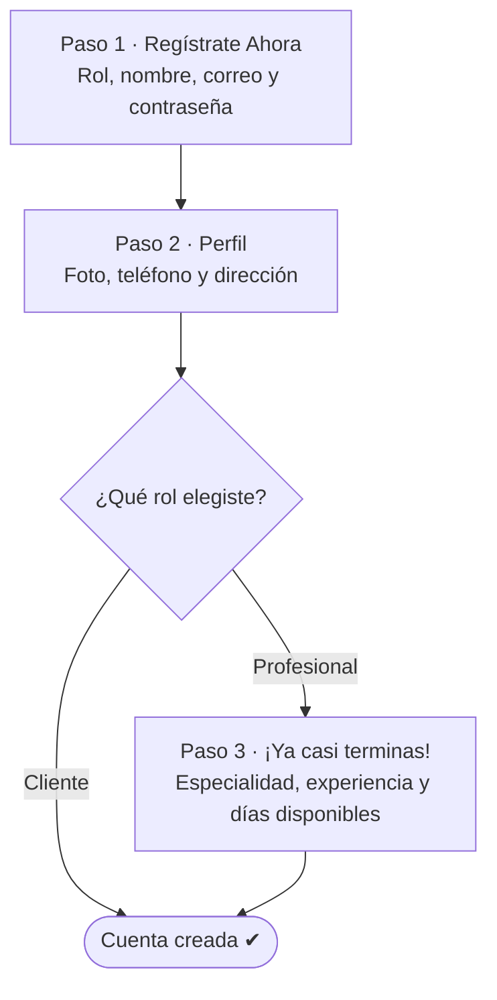
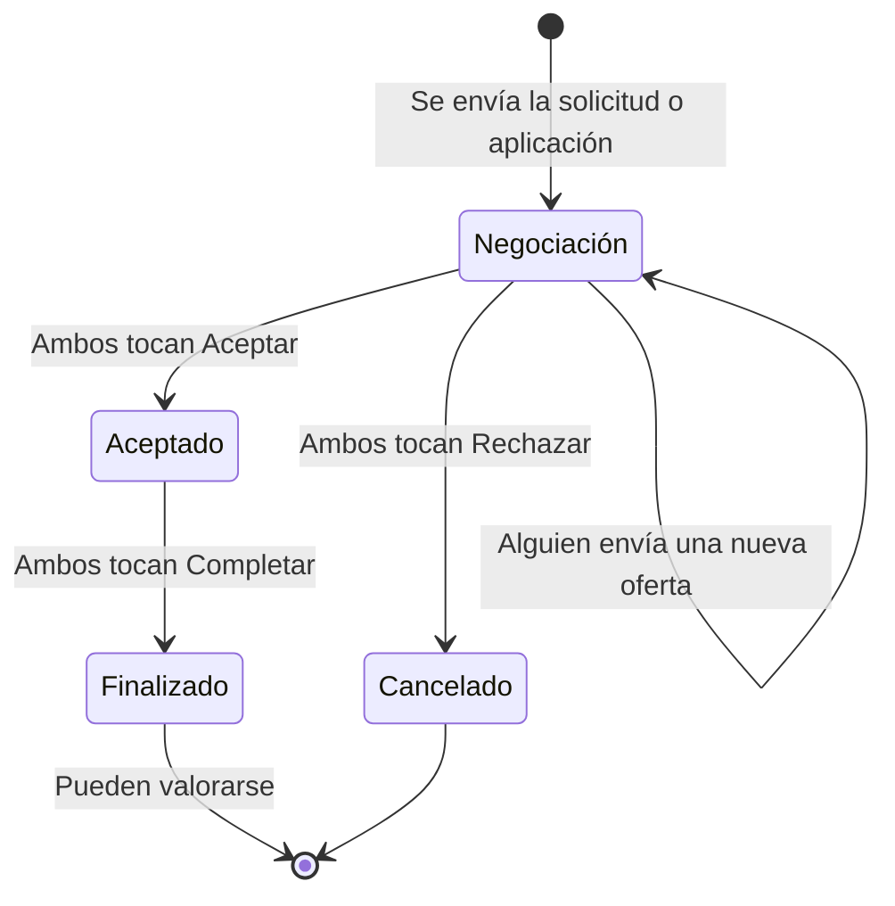

# Manual de usuario de Echo

Bienvenido a **Echo**, la app que conecta a personas que necesitan un servicio técnico con los profesionales que lo ofrecen: plomeros, electricistas, carpinteros, jardineros y más.

Esta guía te acompaña desde que creas tu cuenta hasta que cierras tu primer trato y dejas una valoración. Sigue el orden en el que normalmente usarías la app.

---

## Contenido

1. [¿Qué es Echo?](#1-qué-es-echo)
2. [Crear tu cuenta](#2-crear-tu-cuenta)
3. [Iniciar y cerrar sesión](#3-iniciar-y-cerrar-sesión)
4. [Conoce la app](#4-conoce-la-app)
5. [Guía para Clientes](#5-guía-para-clientes)
6. [Guía para Profesionales](#6-guía-para-profesionales)
7. [Negociar y cerrar un trato](#7-negociar-y-cerrar-un-trato)
8. [Valoraciones](#8-valoraciones)
9. [El chat](#9-el-chat)
10. [Notificaciones](#10-notificaciones)
11. [Tu perfil y configuración](#11-tu-perfil-y-configuración)
12. [Usar Echo sin conexión](#12-usar-echo-sin-conexión)
13. [Preguntas frecuentes](#13-preguntas-frecuentes)

---

## 1. ¿Qué es Echo?

Echo es un punto de encuentro entre la **oferta** y la **demanda** de servicios técnicos. Hay dos tipos de cuenta:

| Rol | ¿Qué puede hacer? |
|---|---|
| **Cliente** | Buscar servicios, enviar solicitudes, publicar contrataciones, negociar y valorar a los profesionales. |
| **Profesional** | Todo lo anterior, y además publicar sus propios servicios y aplicar a las contrataciones de otros usuarios. |

En Echo hay dos maneras de conectar:

- **Servicios.** Un profesional publica lo que ofrece (por ejemplo, "Instalación de minisplit") con fotos y un precio base. Tú lo encuentras y le envías una **solicitud**.
- **Contrataciones.** Es el camino inverso: tú publicas lo que necesitas (por ejemplo, "Reparar fuga en el baño") con fotos y un presupuesto, y los profesionales **aplican**.

En ambos casos se abre un chat donde las dos partes negocian el precio y la fecha hasta llegar a un acuerdo.

> **Nota:** Echo no procesa pagos. El precio que acuerdan en la app es un compromiso entre ustedes, y la forma de pago se arregla directamente con la otra persona.

**Antes de empezar, necesitas:**

- Conexión a internet para registrarte y para la mayoría de las acciones. Algunas funciones operan sin conexión; consulta la [sección 12](#12-usar-echo-sin-conexión).
- Dar permisos de **ubicación** (para llenar tu dirección), y de **cámara** o **galería** (para tu foto de perfil y las fotos de servicios).

---

## 2. Crear tu cuenta

Al abrir la app verás la pantalla de inicio de sesión. Toca **Crea una** (en "¿Aún no tienes cuenta?") para empezar.

El registro tiene **2 pasos para Clientes** y **3 pasos para Profesionales**:

### Paso 1: Regístrate Ahora

1. **Elige tu rol:** **Cliente** o **Profesional**.
   > **Importante:** el rol solo se elige aquí y **no se puede cambiar después**. Si piensas ofrecer servicios, elige **Profesional**. Un profesional también puede contratar servicios de otros.
2. **Nombre:** de 3 a 60 caracteres.
   > **Nota:** por ahora este campo solo acepta letras sin acentos y espacios. Escribe, por ejemplo, "Maria Nunez" en lugar de "María Núñez".
3. **Correo electrónico:** debe ser un correo válido que no esté registrado ya en Echo.
4. **Contraseña:** entre 8 y 20 caracteres.
5. **Confirmar contraseña:** debe coincidir con la anterior.
6. Toca **Continuar**.

### Paso 2: Datos de perfil

1. **Foto de perfil (opcional):** toca el círculo y elige **Cámara** o **Galería**. La imagen se recorta en forma cuadrada.
2. **Ubicación:** la app te pedirá permiso de ubicación y llenará automáticamente **Ciudad**, **Estado** y **Código Postal**. Revisa que estén bien.
3. Completa los campos (todos son obligatorios):
   - **Teléfono:** de 10 a 15 dígitos. Puedes incluir el signo `+`.
   - **Dirección**
   - **Ciudad** y **Estado**
   - **Código Postal:** exactamente 5 dígitos.
4. Toca **Continuar**.

Si eres **Cliente**, tu cuenta queda creada y entras a la app.

### Paso 3: ¡Ya casi terminas! (solo Profesionales)

Completa tu perfil profesional:

- **Descripción personal:** una breve presentación sobre ti y tu trabajo.
- **Especialidad:** elige la categoría principal de tu oficio.
- **Años de experiencia:** número entero de 0 a 100.
- **Días disponibles:** toca los días en los que trabajas (Do, Lu, Ma, Mi, Ju, Vi, Sa). Debes elegir al menos uno.

Toca **Registrar** y listo: entrarás directamente a la app.

---

## 3. Iniciar y cerrar sesión

### Iniciar sesión

En la pantalla **Bienvenido de Vuelta**:

1. Escribe tu **Correo** y tu **Contraseña**. Con el ícono del ojo puedes mostrar u ocultar la contraseña.
2. Toca **Ingresar**.

Si algo falla, verás uno de estos mensajes:

| Mensaje | Qué hacer |
|---|---|
| "Credenciales incorrectas…" | Revisa que el correo y la contraseña estén bien escritos. |
| "No se pudo iniciar sesión sin conexión…" | Conéctate a internet. Ver más abajo. |
| "Ocurrió un error al iniciar sesión…" | Espera un momento e inténtalo de nuevo. |

**Inicio de sesión sin internet:** solo funciona si ya iniciaste sesión con esa cuenta **en este mismo dispositivo** estando en línea, y usas la misma contraseña.

> **Nota:** por ahora la app no tiene la opción de recuperar la contraseña. Guárdala en un lugar seguro.

### Cerrar sesión

Ve a la pestaña **Perfil**, baja hasta el final y toca **Cerrar Sesión**. Funciona aunque no tengas conexión.

---

## 4. Conoce la app

Una vez dentro verás cuatro pestañas en la parte inferior. Son las mismas para Clientes y Profesionales:

| Pestaña | Para qué sirve |
|---|---|
| **Inicio** | Explorar servicios y contrataciones, buscar y filtrar por categoría. |
| **Solicitudes** | Todas tus negociaciones, tanto las que enviaste como las que recibiste. |
| **Notificaciones** | Avisos de nuevas solicitudes, ofertas, respuestas y valoraciones. Un globo rojo indica cuántas tienes sin leer. |
| **Perfil** | Tus datos, tus estadísticas, publicar servicios o contrataciones, y la configuración. |

---

## 5. Guía para Clientes

> Todo lo de esta sección también lo pueden hacer los Profesionales cuando necesitan contratar a alguien.

### 5.1 Explorar y buscar servicios

En **Inicio** verás un saludo ("Hola, *tu nombre* 👋") y, debajo:

- **Barra de búsqueda ("Buscar...")**: escribe lo que necesitas y presiona Enter. Se busca en el nombre y la descripción de los servicios.
- **Categorías**: toca una para filtrar. **Todas** muestra todo. Las categorías disponibles son:
  - Albañilería
  - Plomería
  - Instalación de Pisos
  - Electricista
  - Carpintería
  - Pintura
  - Jardinería
  - Limpieza de Fosas y Biodigestores
  - Instalación de Aires Acondicionados
  - Limpieza de Casas y Oficinas
  - Limpieza de Baños
- **Servicios**: tarjetas con foto, nombre, antigüedad de la publicación, calificación promedio (★), distancia aproximada, nombre del profesional y precio base.
- **Contrataciones**: lo que otros usuarios están buscando. También aparecen aquí las tuyas. Toca **Ver en mapa** para verlas en un mapa (ver [5.5](#55-ver-contrataciones-en-el-mapa)).

Si le das permiso de ubicación a Echo, los servicios y las contrataciones **más cercanos y más recientes aparecen primero**, y cada tarjeta muestra la distancia (por ejemplo, "a 3.2 km"). Si no das permiso, se usa la ubicación que registraste al crear tu cuenta. Si tampoco la tienes, verás primero lo más reciente. Para activarla después, toca el aviso **Activa tu ubicación para ver primero lo más cercano**.

Para actualizar la información, toca el ícono de recargar que está junto al saludo.

### 5.2 Ver un servicio

Toca una tarjeta para ver el detalle:

- Galería de fotos.
- Nombre del servicio y **precio base**.
- Nombre del profesional. Tócalo para ver su perfil: especialidad, experiencia, días disponibles y calificación.
- **Descripción**.
- **Valoraciones**: calificación promedio y reseñas de otros clientes.

### 5.3 Solicitar un servicio

1. En el detalle del servicio, toca **Solicitar**.
2. En el formulario **Solicitud de Servicio**, llena:
   - **Oferta inicial:** el precio que propones. Debe ser mayor a 0 y admite hasta 2 decimales.
   - **Fecha:** cuándo necesitas el servicio. No puede ser anterior a hoy.
   - **Notas (opcional):** detalles útiles para el profesional.
3. Toca **Enviar**.

El profesional recibe una notificación y se abre un chat entre ustedes para negociar. Ve a la [sección 7](#7-negociar-y-cerrar-un-trato).

> **Nota:** solo puedes enviar **una solicitud por servicio**. Después de enviarla, el botón cambia a **Mensaje** y te lleva directamente a esa conversación.

### 5.4 Publicar una contratación

Usa esta opción cuando no encuentres el servicio exacto que buscas, o prefieras que los profesionales vengan a ti.

1. Ve a **Perfil** y toca **Publicar contratación**.
2. Llena el **Editor de Contratación**:
   - **Nombre de la Contratación:** por ejemplo, "Pintar fachada de casa".
   - **Descripción:** explica qué necesitas.
   - **Presupuesto base:** cuánto planeas pagar.
   - **Categoría.**
   - **Fotos de referencia:** de 1 a 5. La primera será la portada.
   - **Ubicación del trabajo (opcional):** por defecto es tu ubicación actual. Tócala para mover el mapa y colocar el pin donde se hará el trabajo, o toca **Quitar** para no mostrarla. Los demás solo ven la **zona aproximada** (unos 500 m), nunca tu dirección exacta.
3. Guarda.

Tu contratación aparecerá en **Inicio**, en la sección **Contrataciones**. Cada profesional que aplique abrirá su propia negociación contigo. Las verás todas en **Solicitudes**.

- **Editarla:** mientras esté abierta, toca la insignia **Edit** en su tarjeta.
- **Cierre automático:** cuando completas un trato con uno de los profesionales, la contratación se cierra sola, aparece como **Completada** y nadie más puede aplicar.

### 5.5 Ver contrataciones en el mapa

1. En **Inicio**, junto al título **Contrataciones**, toca **Ver en mapa**.
2. El mapa se centra en tu ubicación y muestra las contrataciones abiertas de la zona visible. Cada una se marca con un círculo que indica su zona aproximada.
3. Mueve o acerca el mapa para buscar en otras zonas. Usa las categorías de arriba para filtrar y el botón de la mira para volver a tu ubicación.
4. Toca un marcador para ver su tarjeta, y toca la tarjeta para abrir el detalle.

> El mapa necesita conexión a internet. Sin conexión, sigue usando la lista de **Inicio**.

---

## 6. Guía para Profesionales

### 6.1 Publicar un servicio

1. Ve a **Perfil** y toca **Publicar nuevo servicio**.
2. Llena el **Editor de Servicio**:
   - **Nombre del Servicio**
   - **Descripción:** qué incluye, materiales, alcance, etc.
   - **Precio base:** mayor a 0. Es un precio de referencia y se puede negociar con cada cliente.
   - **Categoría**
   - **Fotos del servicio:** de 1 a 5. La primera será la portada.
3. Toca **Crear**.

Tu servicio aparecerá en **Inicio** con la etiqueta **Tú** como profesional.

**Editar un servicio:** en **Inicio**, toca la insignia **Edit** de tu tarjeta, haz los cambios y toca **Actualizar**.

> **Tip:** buenas fotos y una descripción clara generan más solicitudes. Usa como portada la foto que mejor muestre tu trabajo.

### 6.2 Recibir solicitudes

Cuando un cliente solicita tu servicio:

- Recibes un aviso en **Notificaciones**.
- La solicitud aparece en **Solicitudes** con el estado **Negociación**.

Abre la solicitud para ver la oferta y negociar. Ve a la [sección 7](#7-negociar-y-cerrar-un-trato).

### 6.3 Aplicar a contrataciones

1. En **Inicio**, revisa la sección **Contrataciones** y abre la que te interese.
2. Toca **Aplicar**.
3. En **Aplicar a Contratación**, indica tu **Oferta inicial**, la **Fecha** y, si quieres, unas **Notas**.
4. Envía tu aplicación.

Solo puedes aplicar **una vez** a cada contratación. Después, el botón cambia a **Mensaje** para que continúes la conversación.

El botón de una contratación puede mostrar otros textos según el caso:

| Botón | Significado |
|---|---|
| **Aplicar** | Puedes enviar tu propuesta. |
| **Mensaje** | Ya aplicaste; te lleva al chat. |
| **Tu contratación** | La publicaste tú. |
| **Solo proveedores pueden aplicar** | Tu cuenta es de Cliente. |
| **Contratación cerrada** / **Contratación completada** | Ya no recibe aplicaciones. |

### 6.4 Tu información profesional

En **Perfil**, sección **Información Profesional**, toca **Editar** para actualizar tu **Especialidad**, tus **Años de experiencia** y tus **Días disponibles**. Esta información la ven los clientes en tu perfil.

---

## 7. Negociar y cerrar un trato

*(Aplica a Clientes y Profesionales.)*

Cada solicitud o aplicación tiene su propio chat. Ábrelo desde **Solicitudes** o con el botón **Mensaje**.

### 7.1 El panel de negociación

En la parte superior del chat está el panel **Propuestas de Negociación**, con:

- El **Precio** y la **Fecha** propuestos en este momento.
- Dos íconos de persona: tú (marcado como **(Tú)**) y la otra parte. Una flecha indica quién hizo la última oferta.
- El color de cada ícono muestra la postura de esa persona:

| Color | Significado |
|---|---|
| 🔵 Azul | Pendiente: aún no responde. |
| 🟢 Verde | Aceptó la propuesta. |
| 🔴 Rojo | Rechazó la propuesta. |
| 🟣 Morado | Marcó el servicio como completado. |

### 7.2 Acciones disponibles

Mientras negocian:

- **Aceptar:** estás de acuerdo con el precio y la fecha actuales.
- **Ofertar:** haces una contraoferta con un nuevo **Precio** y una nueva **Fecha**. Al enviarla, ambas partes vuelven a "pendiente". No puedes contraofertar tu propia última oferta, salvo que la otra parte la haya rechazado.
- **Rechazar:** no estás de acuerdo con la propuesta.

Una vez que ambos aceptaron:

- **Completar:** marca que el servicio ya se realizó.
- **Valorar:** deja una reseña (ver [sección 8](#8-valoraciones)).

Cada acción te pide confirmación antes de aplicarse.

### 7.3 Los estados de una solicitud

La regla clave: **los cambios importantes requieren a las dos partes**.

- Si solo una persona rechaza, la solicitud **no se cancela**. La otra parte todavía puede enviar una contraoferta.
- El trato solo se acepta, se cancela o se finaliza cuando **ambos** tocan el mismo botón.

| Estado (en Solicitudes) | Aviso en el chat | Qué significa |
|---|---|---|
| **Negociación** | — | Están intercambiando propuestas. |
| **Aceptado** | "Trato Aceptado" | Acordaron precio y fecha. Ahora toca realizar el trabajo. |
| **Cancelado** | "Solicitud Cancelada" | Ambos rechazaron. El chat queda deshabilitado. |
| **Finalizado** | "Servicio Completado!" | Ambos confirmaron que el trabajo se hizo. Ya pueden valorarse. |

### 7.4 Ver los detalles de la solicitud

En la parte superior del chat, toca el ícono **⇔** para ver los **Detalles de la solicitud**: quién la publicó, quién es el proveedor y las notas iniciales.

### 7.5 La pestaña Solicitudes

Aquí encuentras todas tus negociaciones, ordenadas por la más reciente. Cada tarjeta muestra:

- Foto y título del servicio o contratación.
- El nombre de la otra persona.
- El estado (Negociación, Aceptado, Cancelado o Finalizado).
- Cuántos mensajes tienes sin leer.
- La propuesta actual.

---

## 8. Valoraciones

Cuando una solicitud llega a **Finalizado**, aparece el botón **Valorar** en el chat.

1. Toca **Valorar**.
2. En **Deja tu Valoración**, elige de 1 a 5 estrellas (obligatorio).
3. Si quieres, escribe tus **Comentarios**.
4. Toca **Enviar Valoración**.

Ten en cuenta:

- Solo puedes valorar **una vez** por servicio o contratación.
- En las contrataciones, quien la publicó es quien valora al profesional.
- Las valoraciones de un servicio aparecen en su detalle y suman a la calificación del profesional.

---

## 9. El chat

Escribe en el campo **"Escribe un mensaje..."** y envía. Por ahora el chat es solo de texto.

Junto a tus mensajes verás un ícono que indica su estado:

| Ícono | Significado |
|---|---|
| ⏳ Indicador girando | Enviando… |
| 🕒 Reloj | En espera de envío. |
| ☁️ Nube tachada | Estás sin conexión; se enviará cuando vuelvas a tener internet. |
| ✔✔ Doble palomita verde | Enviado. |
| ⚠️ Alerta roja | No se pudo enviar. **Tócalo para reintentar.** |

Si escribes sin conexión, tus mensajes se guardan en el teléfono y se envían solos cuando recuperas internet.

---

## 10. Notificaciones

Recibirás un aviso en la pestaña **Notificaciones** cuando:

- Alguien solicita tu servicio o aplica a tu contratación.
- Recibes una nueva oferta.
- La otra parte acepta o rechaza una propuesta.
- Recibes una valoración.

Al abrir la pestaña, todas se marcan como leídas.

> **Nota:** las notificaciones se muestran dentro de la app. Por ahora no llegan avisos al teléfono cuando la app está cerrada. Si estás dentro del chat cuando ocurre algo, es posible que no recibas el aviso, porque ya lo estás viendo.

---

## 11. Tu perfil y configuración

En la pestaña **Perfil** encontrarás:

- **Tu foto:** tócala para cambiarla, desde la cámara o la galería.
- **Tu rol:** Cliente o Profesional.
- **Estadísticas:**
  - **Reseñas:** cuántas valoraciones has recibido.
  - **Servicios:** cuántos trabajos has finalizado.
  - **Calif.:** tu calificación promedio.
- **Información Personal:** Email, Teléfono y Dirección. Toca **Editar**, haz los cambios y toca **Guardar Cambios**.
  > **Nota:** el nombre y el correo no se pueden modificar.
- **Información Profesional** (solo Profesionales). Consulta la [sección 6.4](#64-tu-información-profesional).
- Los botones **Publicar nuevo servicio** (solo Profesionales) y **Publicar contratación**.

### Configuración

- **Tema:** elige **Auto** (sigue el ajuste de tu teléfono), **Claro** u **Oscuro**.
- **Privacidad:** toca **Descargar PDF** para obtener la Política de Privacidad de Echo. En Android se guarda en Descargas; en iPhone se abre el menú para compartir o guardar.

---

## 12. Usar Echo sin conexión

Echo guarda en tu teléfono la información que ya cargaste, así que puedes seguir usando parte de la app sin internet. Cuando no tienes conexión, el ícono junto al saludo en **Inicio** cambia a una nube tachada.

**Funciona sin conexión** (se sincroniza al reconectarte):

- Ver servicios, contrataciones y solicitudes que ya habías cargado.
- Escribir mensajes en el chat.
- Enviar solicitudes, ofertas y respuestas (Aceptar, Rechazar, Completar).
- Editar tu perfil, tu foto, y servicios o contrataciones que ya existen.

**Necesita conexión:**

- Registrarte.
- Iniciar sesión por primera vez en un dispositivo.
- Publicar un servicio o una contratación **nuevos**.
- Enviar valoraciones.
- Ver las estadísticas del perfil. Sin conexión verás "Disponible cuando vuelvas a conectarte".

> **Importante:** si haces una propuesta sin conexión y la otra persona hace cambios antes de que te reconectes, el estado final puede cambiar al sincronizarse. Revisa la negociación cuando vuelvas a tener internet.

---

## 13. Preguntas frecuentes

**¿Olvidé mi contraseña, cómo la recupero?**
Por ahora la app no tiene recuperación de contraseña. Contacta al equipo de Echo.

**¿Puedo cambiar de Cliente a Profesional, o al revés?**
No. El rol se elige al registrarte y no se puede cambiar. Si eres Profesional, también puedes contratar servicios como cualquier cliente.

**¿Puedo eliminar un servicio, una contratación o mi cuenta?**
Por el momento no hay opción para eliminarlos desde la app. Sí puedes editar tus servicios y contrataciones.

**¿Echo cobra o procesa los pagos?**
No. El precio se acuerda en la negociación y el pago se arregla directamente entre cliente y profesional.

**¿Por qué no puedo enviar otra solicitud al mismo servicio?**
Cada cliente puede tener una sola solicitud por servicio. Usa el botón **Mensaje** para continuar esa conversación.

**Rechacé una propuesta, ¿se canceló la solicitud?**
No, a menos que la otra persona también la rechace. Mientras tanto, cualquiera de los dos puede enviar una nueva oferta.

**¿Cuándo puedo dejar una valoración?**
Cuando ambos hayan tocado **Completar** y la solicitud esté en **Finalizado**.

**Un mensaje aparece con una alerta roja.**
No se pudo enviar. Revisa tu conexión y toca el mensaje para reintentar.

**Mi nombre no se acepta al registrarme.**
Escríbelo sin acentos ni "ñ" (por ejemplo, "Jose Pena"). Debe tener entre 3 y 60 letras.

**Me aparece "Error al cargar perfil!" y se cerró mi sesión.**
Revisa tu conexión a internet y vuelve a iniciar sesión.
